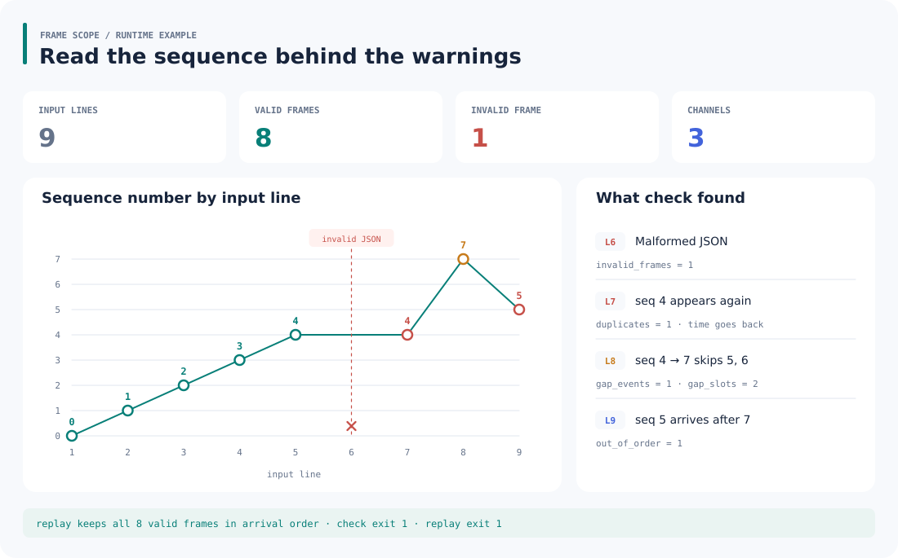

<p></p>

# Frame Scope

检查 NDJSON 测量日志中的坏行、重复帧、乱序、序号跳跃和时间倒退，同时计算逐通道统计。`replay` 可把有效帧按到达顺序重新输出，接到下一步分析管道。

## 运行示例

`examples/mixed.ndjson` 包含 9 行记录：1 行 JSON 损坏，其余 8 帧里有重复、跳号和迟到帧。



图中序列来自样例日志，计数来自 [实际检查结果](assets/demo-report.json)。复现命令：

```sh
python -m frame_scope check examples/mixed.ndjson
python -m frame_scope replay examples/mixed.ndjson > accepted.ndjson
```

两条命令均退出 `1`，表示发现异常。`replay` 仍输出全部 8 个有效帧，保留重复和乱序记录，跳过坏行。

## 快速开始

需要 Python 3.10+，在项目根目录运行，无第三方依赖：

```sh
python -m frame_scope demo --frames 100 --channels 4 > demo.ndjson
python -m frame_scope check demo.ndjson
python -m frame_scope check demo.ndjson --format csv > report.csv
python -m frame_scope demo --frames 10 | python -m frame_scope check -
```

`check` 默认输出 JSON；CSV 使用 `section,metric,channel,value` 长表。数据写到 stdout，逐行诊断写到 stderr，可分别重定向。

## 日志格式

每行一个 JSON 对象，使用以下三个字段：

```json
{"seq":0,"timestamp":0.01,"channels":[0.13,-0.27,0.42]}
```

- `seq`：非负整数；第一帧可以从任意序号开始。
- `timestamp`：以秒计的有限非负数，可使用实验相对时间。
- `channels`：非空有限数值数组；首个有效帧确定通道数。
- 多余字段、重复 JSON 键、通道数变化或无效数值会使该行被跳过；空白行单独计数。
- 默认每行最多 1,048,576 字符，可用 `--max-line-chars` 调整。序号回绕或设备重启应在导入前分段。

## 怎样读检查结果

- `duplicates`：序号此前已经出现过，再出现一次计一次。
- `out_of_order`：首次出现的序号低于此前最大序号，与重复计数互斥。
- `forward_gap_events`：序号向前跨越至少一个槽位的次数。
- `forward_gap_slots`：向前跳跃跨过的槽位总数，迟到帧补齐后也不扣减。
- `timestamp_regressions`：时间低于上一有效帧的时间。

因此图中从 4 跳到 7 记 2 个槽位，之后收到 5，槽位数仍为 2。它描述到达过程，不是最终丢帧数。

所有有效帧都参与通道统计，输出 count、min、max、mean 和总体标准差。JSON 的统计数值为十进制字符串。`replay` 连续输出规范化 NDJSON，时间戳作为数据保留。

退出码：`0` 未发现异常；`1` 发现日志异常；`2` 参数、文件或编码错误。

## 开发

```sh
python -m unittest discover -s tests -v
```

`core.py` 负责帧校验、完整性计数与统计；`__main__.py` 提供演示生成、检查与重放命令。日志逐行处理，重复检测保存已见序号，内存随唯一序号数增长。

许可证：[MIT](LICENSE)。
